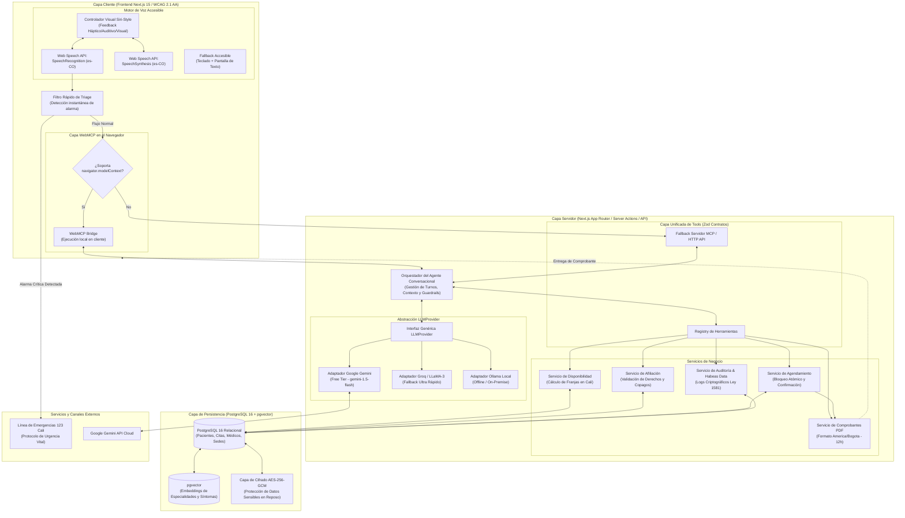
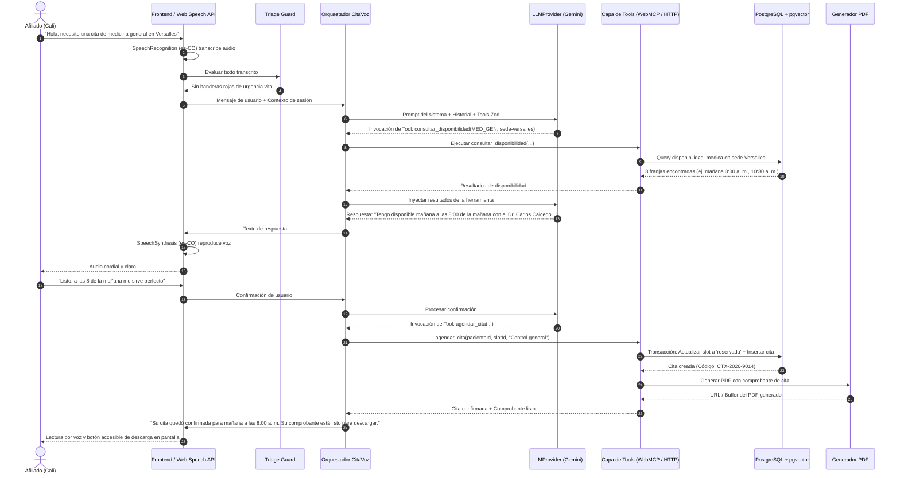

# Arquitectura del Sistema: CitaVoz EPS
## EPS TRIADIX (Cali, Colombia)

---

## 1. Visión General de la Arquitectura
**CitaVoz EPS** es una plataforma de agendamiento conversacional por voz diseñada para **EPS TRIADIX**, orientada a usuarios de todas las edades en Cali, especialmente adultos mayores y personas en situación de discapacidad motriz o visual.

La arquitectura sigue los principios de desacoplamiento, costo cero (usando herramientas open-source y tiers gratuitos de LLM), tipado estricto extremo a extremo con TypeScript y Zod, y estricto apego a la normativa de datos sensibles de salud en Colombia (Ley 1581 de 2012 y Decreto 1377 de 2013).

---

## 2. Diagrama de Componentes del Sistema



---

## 3. Descripción Detallada de Componentes

### 3.1. Frontend de Voz Accesible
- **Speech Recognition (`es-CO`)**:
  - Utiliza `webkitSpeechRecognition` / `SpeechRecognition` nativo con dialecto configurado en `es-CO` y fallback a `es-419`.
  - Sistema de reconocimiento continuo con umbral de silencio para detección de fin de turno del usuario.
- **Speech Synthesis (`es-CO`)**:
  - Síntesis de voz con tono cordial, calmado y pronunciación colombiana.
  - Pausas estratégicas para facilitar la comprensión de adultos mayores.
- **Interfaz "Siri-Style" & Accesibilidad (WCAG 2.1 AA)**:
  - Onda visual reactiva al volumen de entrada y salida.
  - Botón táctil grande (mínimo 64x64 px) con alto contraste (> 7:1 contra el fondo).
  - Anuncios dinámicos mediante regiones `aria-live="polite"` y `aria-live="assertive"`.
  - Fallback inmediato a teclado y entrada de texto para personas con dificultades del habla o entornos ruidosos.

### 3.2. Orquestador del Agente Conversacional
- Administra el historial de turnos, el estado del agendamiento y el contexto del afiliado autenticado.
- **Defensa en Profundidad contra Prompt Injection**:
  - El LLM **nunca interactúa de manera directa con la base de datos**.
  - El LLM solo puede proponer la llamada a herramientas estrictamente tipadas y validadas mediante esquemas Zod.
  - Si el usuario intenta inyectar instrucciones para modificar precios, obtener datos de otros pacientes o consultar tablas internas, el orquestador descarta la instrucción y mantiene el objetivo de agendamiento.

### 3.3. Proveedor LLM (`LLMProvider`)
Capa de abstracción con interfaz unificada:
```typescript
export interface LLMProvider {
  generateResponse(
    messages: ConversationMessage[],
    availableTools: ToolDefinition[]
  ): Promise<LLMResponse>;
}
```
- **GeminiAdapter**: Implementación principal usando la capa gratuita de Google Gemini (`gemini-1.5-flash`), con soporte nativo de function calling.
- **GroqAdapter**: Implementación para fallback de ultra baja latencia con modelos como `llama-3.3-70b-versatile`.
- **OllamaAdapter**: Soporte para entornos locales u on-premise desconectados de internet.

### 3.4. Capa de Tools: WebMCP (`navigator.modelContext`) y Fallback HTTP
- **WebMCP**: Si el navegador del usuario implementa el estándar experimental `navigator.modelContext`, las herramientas del agente se exponen directamente al contexto del navegador, permitiendo invocaciones con latencia mínima en el cliente.
- **Servidor MCP / HTTP API Fallback**: Si el navegador no soporta `navigator.modelContext`, se utiliza exactamente el mismo catálogo de herramientas ejecutado desde el servidor Next.js a través de Server Actions o API endpoints REST/JSON-RPC.
- **Catálogo de Tools Compartido**:
  1. `verificar_identidad_afiliado(tipoDoc, numeroDoc)`
  2. `consultar_sedes_cali(zona?, comuna?)`
  3. `consultar_disponibilidad(especialidadId, sedeId?, fechaInicio?, fechaFin?)`
  4. `agendar_cita(afiliadoId, slotId, motivoConsulta)`
  5. `consultar_citas_activas(afiliadoId)`
  6. `reprogramar_cita(citaId, nuevoSlotId)`
  7. `cancelar_cita(citaId, motivo)`
  8. `generar_comprobante_pdf(citaId)`
  9. `activar_protocolo_urgencia(motivoAlarma)`

### 3.5. Servicio de Disponibilidad & Agendamiento
- Gestiona las franjas horarias médicas respetando la zona horaria `America/Bogota` (UTC-5).
- Soporta bloqueo atómico en base de datos para evitar colisiones cuando dos afiliados intentan seleccionar la misma franja horaria simultáneamente.

### 3.6. Servicio de Comprobantes PDF
- Genera un archivo PDF liviano y accesible que incluye:
  - Membrete oficial de **EPS TRIADIX**.
  - Código único de cita (ej. `CTX-2026-7841`).
  - Datos del paciente (nombre, tipo y número de documento).
  - Fecha en formato colombiano `DD/MM/AAAA` y hora en formato 12 horas con `a. m.` / `p. m.`.
  - Nombre del profesional de la salud y registro médico (RETHUS).
  - Dirección completa de la sede en Cali y recomendaciones de preparación médica (ayuno, llegar 20 minutos antes, documento original).
  - Código QR de validación rápida en la entrada de la sede.

### 3.7. PostgreSQL 16 con pgvector
- **Persistencia Relacional**: Almacenamiento íntegro de sedes, médicos, pacientes, citas, consentimientos y logs.
- **Extensión pgvector**: Permite búsqueda de similitud de cosenos sobre vectores de especialidades médicas a partir del motivo expresado por el usuario en lenguaje coloquial (ej. *"me duele una muela"* -> `ODONT`, *"no veo bien de lejos"* -> `OPTOM`).
- **Cifrado en Reposo**: Cifrado simétrico autenticado AES-256-GCM para datos sensibles de salud de los pacientes.

---

## 4. Diagrama de Secuencia: Flujo Completo de Agendamiento por Voz



---

## 5. Estrategia de Redundancia y Continuidad Operativa (Costo Cero)

| Componente | Opción Primaria | Opción Secundaria / Fallback | Mecanismo de Activación |
| :--- | :--- | :--- | :--- |
| **Entrada de Usuario** | Web Speech Recognition (`es-CO`) | Formulario accesible por teclado y texto | Fallo de permisos, ruido excesivo o navegador incompatible. |
| **Salida de Audio** | Web Speech Synthesis (`es-CO`) | Mensajes de texto en pantalla (`aria-live`) | Ausencia de sintetizador de voz o preferencia del usuario. |
| **Herramientas del Agente** | WebMCP (`navigator.modelContext`) | Endpoints API / Server Actions HTTP | Ausencia de soporte de WebMCP en el navegador cliente. |
| **Modelo LLM** | Google Gemini 1.5 Flash (Free Tier) | Groq (Llama-3.3-70B) / Ollama | Cuota superada (HTTP 429) o latencia mayor a 4 segundos. |
| **Base de Datos** | PostgreSQL 16 + pgvector (Docker) | PGlite local (WASM + pgvector) | Entorno de desarrollo local sin contenedor activo. |
