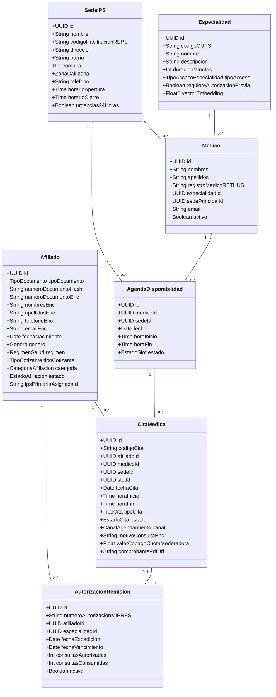
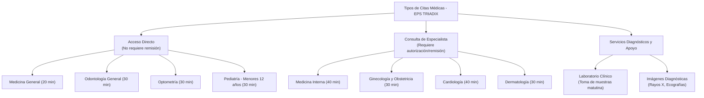
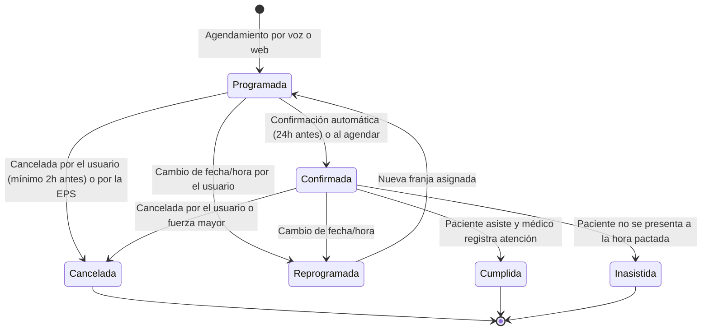

# Modelo de Dominio de Salud: EPS TRIADIX
## Sistema General de Seguridad Social en Salud (SGSSS) - Colombia

---

## 1. Introducción al Dominio
Este documento describe el modelo de dominio para el sistema de agendamiento de citas médicas **CitaVoz EPS** de **EPS TRIADIX** en la ciudad de **Santiago de Cali, Valle del Cauca**. 

El modelo refleja estrictamente las reglas, clasificaciones y normativas establecidas por el Ministerio de Salud y Protección Social de Colombia, la Superintendencia Nacional de Salud (Supersalud), la Ley 100 de 1993, la Ley 1122 de 2007, la Ley 1438 de 2011 y la Ley Estatutaria de Salud 1751 de 2015.

---

## 2. Entidades Principales del Dominio

---

## 3. Detalle de Atributos y Reglas de Negocio

### 3.1. Afiliados (Pacientes)
- **Tipos de Documento de Identidad Oficial en Colombia**:
  - `CC`: Cédula de Ciudadanía (ciudadanos mayores de 18 años).
  - `TI`: Tarjeta de Identidad (menores de 7 a 17 años).
  - `RC`: Registro Civil (niños de 0 a 6 años).
  - `CE`: Cédula de Extranjería (residentes extranjeros).
  - `PA`: Pasaporte (extranjeros con permanencia regular).
- **Régimen de Salud**:
  - `CONTRIBUTIVO`: Personas vinculadas a través de contrato de trabajo, servidores públicos, pensionados o trabajadores independientes con capacidad de pago.
    - Tipos: `Cotizante` o `Beneficiario`.
  - `SUBSIDIADO`: Población sin capacidad de pago clasificada en los grupos vulnerables mediante la encuesta Sisbén IV.
- **Categorías de Cuota Moderadora y Copagos (Año 2026)**:
  - *Régimen Contributivo*:
    - **Categoría A**: Ingresos menores a 2 Salarios Mínimos Mensuales Legales Vigentes (SMMLV). Cuota moderadora mínima.
    - **Categoría B**: Ingresos entre 2 y 5 SMMLV. Cuota moderadora media.
    - **Categoría C**: Ingresos superiores a 5 SMMLV. Cuota moderadora plena.
  - *Régimen Subsidiado*: Exentos de cuota moderadora para consulta externa ordinaria; copagos solo para servicios específicos según clasificación Sisbén (Grupos A y B exentos).
- **Estados de Afiliación**:
  - `ACTIVO`: Con derechos vigentes para agendar consultas en toda la red de EPS TRIADIX.
  - `SUSPENDIDO`: Por mora en aportes (cotizante independiente/empleador en mora) o falta de actualización de documentos (ej. niño cumplió 7 años y no aportó Tarjeta de Identidad). El agente no agenda y orienta respetuosamente a regularización.
  - `RETIRADO`: Afiliación cancelada o traslado a otra EPS.
  - `PROTECCION_LABORAL`: Periodo de gracia posterior a la terminación de contrato laboral (hasta 30 o 90 días con cobertura básica de urgencias y consulta externa prioritaria).

---

### 3.2. Red de Sedes e IPS en Cali (EPS TRIADIX)
Las sedes están distribuidas estratégicamente por comunas y zonas geográficas de Cali para garantizar accesibilidad y cercanía a los afiliados:

| Sede | Dirección | Barrio | Comuna | Zona de Cali | Horario Atención | Servicios Destacados |
| :--- | :--- | :--- | :---: | :---: | :---: | :--- |
| **Sede Tequendama (Principal)** | Calle 5 # 42-25 | Tequendama | 19 | Sur | 06:00 a 19:00 | Consulta Externa, Optometría, Urgencias Básicas |
| **Sede Versalles** | Av. 5A Norte # 21N-40 | Versalles | 2 | Norte | 06:00 a 19:00 | Medicina General, Medicina Interna, Laboratorio |
| **Sede Pasoancho** | Calle 13 # 66-50 | Pasoancho | 17 | Sur | 07:00 a 18:00 | Odontología General, Promoción y Prevención |
| **Sede San Fernando** | Carrera 36 # 4B-10 | San Fernando | 3 | Centro/Oeste | 06:30 a 18:30 | Pediatría, Vacunación, Crecimiento y Desarrollo |
| **Sede El Diamante** | Carrera 28D # 42-15 | El Diamante | 13 | Oriente | 07:00 a 17:30 | Medicina General, Salud Familiar, Odontología |

---

### 3.3. Especialidades Médicas y Tipos de Cita

#### Regla de Negocio sobre Autorizaciones y Remisiones
1. **Acceso Directo**: Cualquier afiliado activo puede agendar citas de Medicina General, Odontología General, Optometría o Pediatría sin necesidad de orden previa.
2. **Especialistas**: Para agendar con especialistas (ej. Medicina Interna, Ginecología, Cardiología), el sistema valida la existencia de una orden/remisión médica emitida en los últimos **90 días calendario** y con saldo de consultas disponible. Si no existe, el agente explica amablemente:
   > *"Para consultar con el especialista en Medicina Interna se requiere una orden emitida previamente por su médico general. ¿Desea que agendemos primero una cita de Medicina General para que el doctor realice su valoración y remisión?"*

---

### 3.4. Ciclo de Vida y Estados de la Cita Médica

- **Definición de Estados**:
  - `Programada`: Franja bloqueada exitosamente a nombre del paciente.
  - `Confirmada`: El paciente ratifica su asistencia mediante voz, mensaje o directamente en el diálogo inicial.
  - `Cancelada`: Cita liberada; la franja horaria vuelve automáticamente al estado `disponible` para otros afiliados.
  - `Reprogramada`: Se libera la franja original y se asocia una nueva franja sin perder la trazabilidad de la cita anterior.
  - `Cumplida`: La atención médica fue completada en la sede.
  - `Inasistida`: El paciente no acudió y no canceló con la antelación requerida (se registra para métricas de oportunidad y adherencia).

---

### 3.5. Políticas Operativas de Agendamiento
1. **Límite de Citas Coincidentes**: Un afiliado no puede agendar más de una cita de la misma especialidad en el mismo día.
2. **Ventana de Cancelación**: La cancelación por voz o web debe realizarse al menos **2 horas antes** del horario programado para dar oportunidad de reasignación del cupo.
3. **Puntualidad en Sede**: Se instruye al usuario a presentarse con **20 minutos de anticipación** en la sede para el trámite de facturación de cuota moderadora y verificación de documentos.
4. **Vigencia de Agendas**: Las agendas se publican quincenalmente con un horizonte de disponibilidad de hasta **30 días calendario**.

