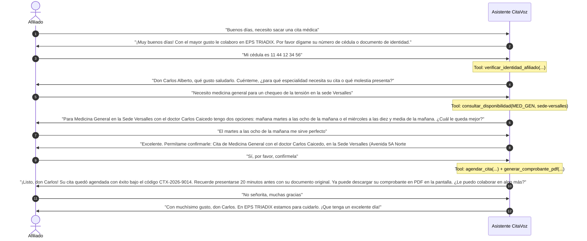
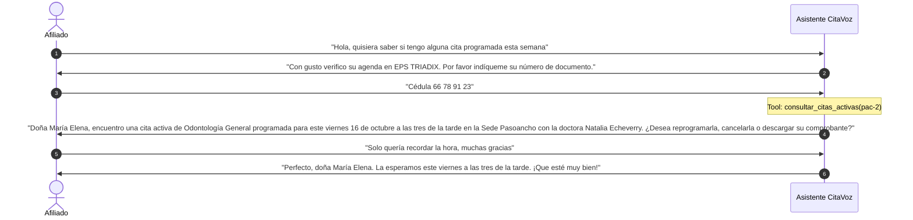
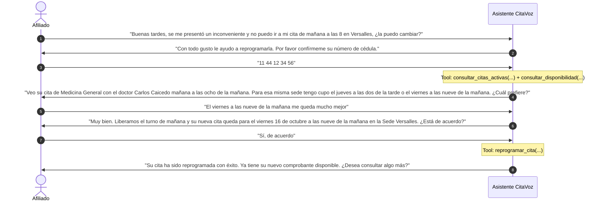
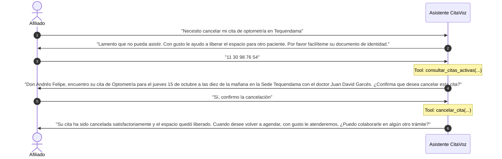
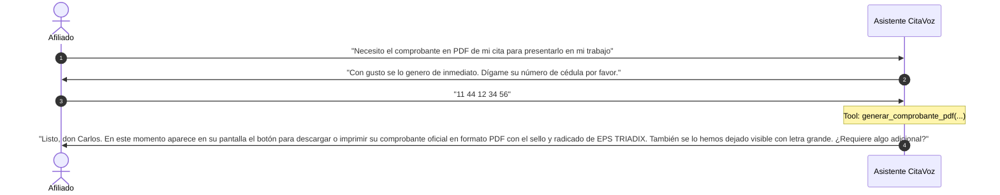

# Flujos Conversacionales y Casos Borde: CitaVoz EPS
## EPS TRIADIX (Cali, Colombia)

---

## 1. Pautas de Tono, Voz y Trato
- **Tono General**: Cálido, empático, respetuoso y formal (trato de "usted" por defecto, característico del trato respetuoso en el Valle del Cauca y accesible para personas mayores).
- **Ritmo de Voz**: Moderado (aprox. 130-140 palabras por minuto), con pronunciación clara y pausas naturales.
- **Formato Temporal en Diálogo**: 
  - Horas expresadas en formato 12 horas con adjetivo coloquial natural (ej. *"a las ocho de la mañana"*, *"a las tres y media de la tarde"*).
  - Fechas referenciadas con día de la semana y fecha (ej. *"este jueves, 15 de octubre"*).

---

## 2. Flujos Conversacionales Principales

### Flujo 1: Agendamiento de Cita Médica (Happy Path)

---

### Flujo 2: Consulta de Citas Activas

---

### Flujo 3: Reprogramación de Cita Existente

---

### Flujo 4: Cancelación de Cita Médica

---

### Flujo 5: Descarga / Entrega de Comprobante PDF por Voz

---

## 3. Protocolos de Casos Borde y Excepciones

### CB-1: Sin Disponibilidad en la Sede o Fecha Solicitada
* **Contexto**: El paciente pide cita para una sede específica y no hay franjas libres en los próximos días.
* **Comportamiento del Agente**: En lugar de rechazar secamente, busca alternativas proactivamente en otras sedes de Cali cercanas o fechas inmediatamente posteriores.
* **Diálogo**:
  > **Asistente**: *"Don Carlos, para la Sede Tequendama no tengo agenda disponible para Medicina General esta semana. Sin embargo, en nuestra **Sede Pasoancho** (en la Calle 13 con 66) tengo disponibilidad para pasado mañana a las nueve de la mañana; o si prefiere esperar en Tequendama, la primera fecha libre es el próximo lunes. ¿Le gustaría tomar la cita en Pasoancho o prefiere el próximo lunes?"*

---

### CB-2: Afiliación Inactiva o Suspendida (Mora o Documentos)
* **Contexto**: Al verificar el documento del afiliado, el estado figura como `SUSPENDIDO` o `RETIRADO`.
* **Comportamiento del Agente**: Trato digno y respetuoso, sin emitir juicios ni tecnicismos acusatorios. Explica el motivo de la restricción y suministra el canal de solución.
* **Diálogo**:
  > **Asistente**: *"Doña María Elena, al consultar el sistema encuentro que su estado de afiliación presenta actualmente una suspensión preventiva, posiblemente por actualización de documentos o novedades en los aportes. Para su seguridad y para que no pierda su viaje a la sede, le recomiendo comunicarse a nuestra línea de atención administrativa al (602) 489-8000 opción 2 o ingresar a nuestro portal web para normalizar su estado. Si se trata de una urgencia médica, recuerde que puede acudir a cualquier centro de salud."*

---

### CB-3: Especialidad Requiere Autorización/Remisión Médica Previa
* **Contexto**: El usuario pide cita con un especialista (ej. Medicina Interna o Cardiología) pero no tiene orden médica vigente en el sistema.
* **Comportamiento del Agente**: Informa la normativa del sistema de salud y ofrece de inmediato agendar la consulta de medicina general para obtener la remisión.
* **Diálogo**:
  > **Asistente**: *"Don Andrés, para acceder a la consulta con el especialista en Medicina Interna, el Ministerio de Salud exige contar con una orden o remisión vigente emitida por su médico general. En el sistema no registramos una orden activa en los últimos noventa días. ¿Le gustaría que le agendemos una cita prioritaria de Medicina General para que el doctor evalúe su caso y emita la remisión?"*

---

### CB-4: Usuario Cambia de Opinión a Mitad de Camino
* **Contexto**: El usuario ya había seleccionado un horario o sede y repentinamente cambia de parecer (*"espere, mejor en la tarde"*, *"no, en Versalles me queda muy lejos, mejor en Tequendama"*).
* **Comportamiento del Agente**: Flexibilidad conversacional total; el agente no obliga al usuario a reiniciar desde cero, reconoce la rectificación, reajusta los parámetros y consulta nuevamente.
* **Diálogo**:
  > **Usuario**: *"Espere señorita, pensándolo bien en Versalles me queda muy lejos con el trancón, ¿no tiene mejor en Tequendama por la tarde?"*  
  > **Asistente**: *"¡Por supuesto, no se preocupe! Busquemos entonces en la Sede Tequendama en horario de la tarde. En Tequendama tengo disponible este miércoles a las tres y media de la tarde con la doctora Valentina Ospina. ¿Le queda más cómodo ese horario?"*

---

### CB-5: Ruido Ambiental, Baja Confianza o Reconocimiento Fallido
* **Contexto**: El usuario habla en un entorno ruidoso (tráfico de Cali, transporte público), balbucea o el micrófono no capta bien.
* **Comportamiento del Agente**: Máximo 2 reintentos cordiales con instrucción de síntesis. Al segundo fallo, la interfaz despliega automáticamente un teclado accesible con opciones táctiles de gran tamaño.
* **Diálogo**:
  > **Intento 1**: *"Disculpe, no le escuché con claridad. ¿Podría repetirme por favor su número de documento un poco más despacio?"*  
  > **Intento 2**: *"Sigo teniendo un poco de dificultad para escucharle debido al ruido de fondo. En la pantalla le he colocado los botones para que pueda escribir su número o presionar una opción con el dedo o teclado."*

---

### CB-6: Detección de Urgencia Médica Vital (Protocolo Línea 123 Cali)
* **Contexto**: El usuario menciona síntomas de peligro vital (dolor opresivo en el pecho, infarto, ahogo o asfixia, sangrado profuso, derrame/ACV, convulsiones, ideación suicida).
* **Comportamiento del Agente**: **INTERRUPCIÓN INMEDIATA Y TOTAL** del flujo de agendamiento. El agente no busca citas ni pide más datos. Emite un mensaje sonoro y visual prioritario, activando el enlace directo a la **Línea de Emergencias 123 de Cali**.
* **Diálogo**:
  > **Usuario**: *"Doctora, tengo un dolor insoportable en el pecho que se me sube al cuello y no puedo casi respirar"*  
  > **Asistente (Tono Firme y Empático)**: *"⚠️ ALERTA MÉDICA: Por favor deténgase y escúcheme con atención. Los síntomas que me describe corresponden a una urgencia vital que NO puede esperar a una cita médica programada. Su vida es lo más importante: por favor comuníquese ya mismo a la Línea de Emergencias 123 en Cali o acuda inmediatamente a la clínica de urgencias más cercana, como nuestra Sede Tequendama o el Hospital Universitario del Valle. En su pantalla tiene el botón directo para llamar al 123."*

