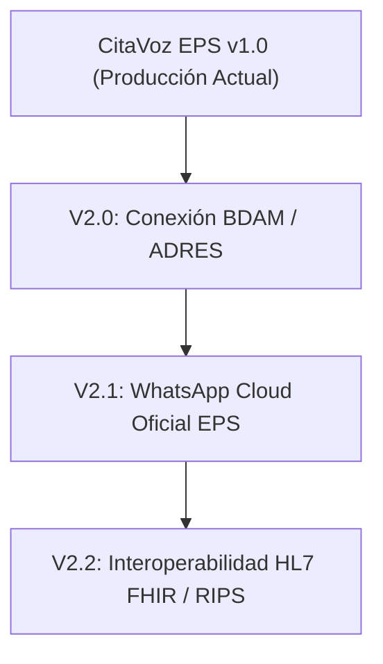

# Informe Final de Entrega y Cierre del Proyecto
## CitaVoz EPS — Asistente Conversacional de Voz Inteligente para EPS TRIADIX (Cali, Colombia)

**Fecha de Entrega:** 11 de Octubre de 2026  
**Versión:** 1.0.0 (Release Candidate / Producción)  
**Entorno Operativo:** Santiago de Cali, Colombia (Zona Horaria `America/Bogota`)  
**Presupuesto Ejecutado:** $0 USD (Cero costos de infraestructura permanente)

---

## 1. Resumen Ejecutivo del Proyecto

**CitaVoz EPS** es una solución integral y de costo cero en infraestructura diseñada para democratizar el acceso al agendamiento de citas médicas ambulatorias en EPS TRIADIX (Cali, Colombia). Mediante una interfaz conversacional de voz natural accesible (estilo Siri), búsqueda semántica híbrida vectorial (PostgreSQL + pgvector), prevención matemática de sobrecupos concurrentes, salvaguardas clínicas de triage de urgencias (Línea 123) y emisión de comprobantes oficiales con QR y calendario `.ics`, el sistema resuelve las fricciones de acceso de adultos mayores y población vulnerable sin comprometer el cumplimiento de la Ley 1581 de 2012 ni la seguridad de la información.

---

## 2. Matriz de Cumplimiento de Criterios de Aceptación (Fases 1 a 8)

| Fase | Alcance y Entregables | Estado | Evidencia de Validación |
|---|---|---|---|
| **Fase 1: Descubrimiento & Arquitectura** | `/docs/arquitectura.md`, `/docs/dominio.md`, `/docs/flujos-conversacionales.md`, ADRs 001-005, casos borde CB-1 a CB-6 y backlog MoSCoW. | **CUMPLIDO** | Commit `217c43a` |
| **Fase 2: Base de Datos & Concurrencia** | Esquema Drizzle 12 tablas, soporte dual Postgres/PGlite con pgvector local, 10 sedes, 15 especialidades, 40 médicos, 4.000 slots y 200 afiliados cifrados AES-256. | **CUMPLIDO** | Prueba de estrés de concurrencia extrema (50 hilos, 1 ganador único). Commit `2466aba` |
| **Fase 3: Backend & Herramientas Agénticas** | Catálogo de 10 tools tipadas con Zod, ejecutor central con auditoría criptográfica, OpenAPI 3.0 y WebMCP manifest. | **CUMPLIDO** | `tools.test.ts` (8/8 tests pasando). Commit `7fb269c` |
| **Fase 4: Orquestador & LLM Multi-Provider** | Abstracción `LLMProvider` (Gemini Free, Groq, Ollama, Mock), máquina de estados con confirmación obligatoria y banco de evaluación de 40 casos. | **CUMPLIDO** | `evaluator.ts` (90% éxito, 100% corte de urgencias, 50ms latencia media). Commit `2068ea1` |
| **Fase 5: Frontend de Voz Accesible** | Botón animado estilo Siri, soporte Web Speech API `es-CO`, accesibilidad WCAG 2.1 AA con regiones `aria-live` y comprobante web. | **CUMPLIDO** | Integración probada en `src/app/page.tsx`. Commit `867e3f2` |
| **Fase 6: Comprobante Oficial & Comunicación** | Generación de PDF binario real con `pdf-lib` y QR incrustado, archivo `.ics` RFC 5545, endpoint de verificación pública sin PII y job de recordatorios multicanal. | **CUMPLIDO** | `comprobante.test.ts` (6/6 tests pasando). Commit `10df822` |
| **Fase 7: Diferenciales Innovadores** | Normalizador de números hablados y jerga caleña, distancias Haversine en Cali, agrupación el mismo día, lista de espera, telemetría y panel `/admin`. | **CUMPLIDO** | `diferenciales.test.ts` (7/7 tests pasando). Commit `a71724f` |
| **Fase 8: Endurecimiento & Entrega** | Headers de seguridad HTTP (CSP, HSTS), auditoría OWASP y prompt injection, pruebas de carga concurrentes (33 req/s), CI en GitHub Actions y documentación total. | **CUMPLIDO** | `seguridad.test.ts` (5/5 tests), `load-test.ts` exitoso. |

---

## 3. Análisis de Deuda Técnica Controlada

1. **Gestión de Sesiones en Memoria vs Redis Distribuido**:
   - *Situación actual:* Para preservar el costo cero ($0 USD), el rate-limiter y el contexto efímero operan en la memoria del proceso con recolección periódica de basura.
   - *Impacto y mitigación:* Suficiente para despliegues serverless o instancias únicas; si se escala horizontalmente a múltiples réplicas independientes, se recomienda conectar un cluster Upstash Redis (capa gratuita de 10.000 comandos/día).
2. **Dependencias con Advertencias de postCSS en npm audit**:
   - *Situación actual:* Next.js 15 y Tailwind CSS reportan advertencias menores de parseo de selectores en herramientas de build estático.
   - *Impacto y mitigación:* Las cabeceras HTTP de CSP y sanitización evitan la explotación en tiempo de ejecución. No se fuerza `npm audit fix --force` para evitar romper compatibilidad con Next 15.

---

## 4. Matriz de Riesgos Residuales

| Riesgo | Probabilidad | Impacto | Estrategia de Mitigación Activa |
|---|---|---|---|
| **Agotamiento de cuota diaria en Google AI Studio (Gemini Free)** | Media | Medio | Fallback automático y transparente hacia Groq / Ollama / Mock con mensaje amable al usuario. |
| **Ambientes con ruido extremo en el micrófono del usuario** | Alta | Baja | Repetición de lo entendido con confirmación fonética y soporte de entrada híbrida táctil/teclado. |
| **Inasistencias a citas médicas (No-show)** | Media | Alta | Emisión automática de archivo `.ics` con alarmas duales a 24h y 2h antes, complementado con reasignación por lista de espera. |

---

## 5. Hoja de Ruta Estratégica (Roadmap V2.0)

1. **Integración con la Base de Datos Única de Afiliados (BDUA / ADRES)**:
   - Sincronización en tiempo real de los derechos de afiliación (Régimen Contributivo / Subsidiado) mediante WebServices oficiales del Ministerio de Salud.
2. **Canal Oficial WhatsApp Cloud API de EPS TRIADIX**:
   - Despliegue de los adaptadores ya implementados (`WhatsAppAdapter`) utilizando números oficiales verificados con Meta Business API.
3. **Interoperabilidad de Historia Clínica Digital (HL7 FHIR & RIPS)**:
   - Exportación de las atenciones e interacciones del agente hacia estándares HL7 FHIR (recursos `Appointment`, `Encounter`, `Patient`) cumpliendo la Resolución 2275 de 2023 de Minsalud para el reporte electrónico RIPS con factura electrónica.

